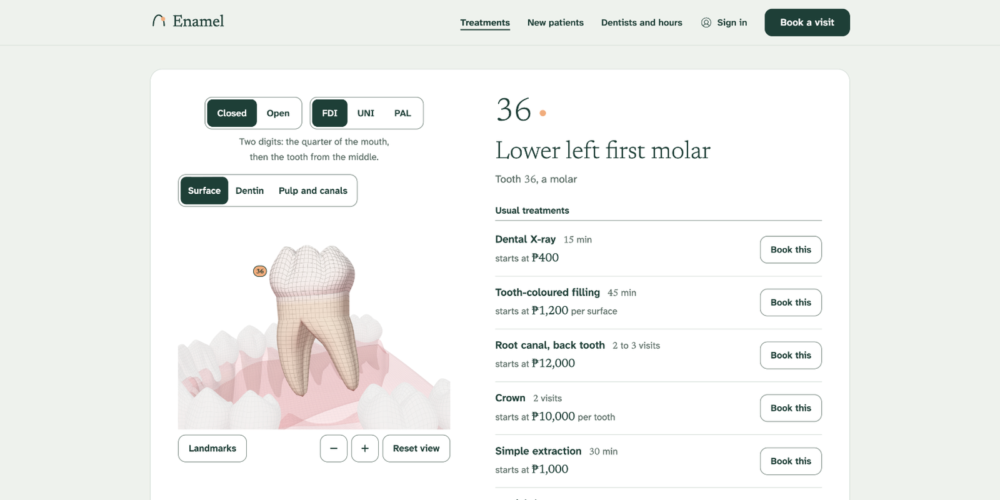
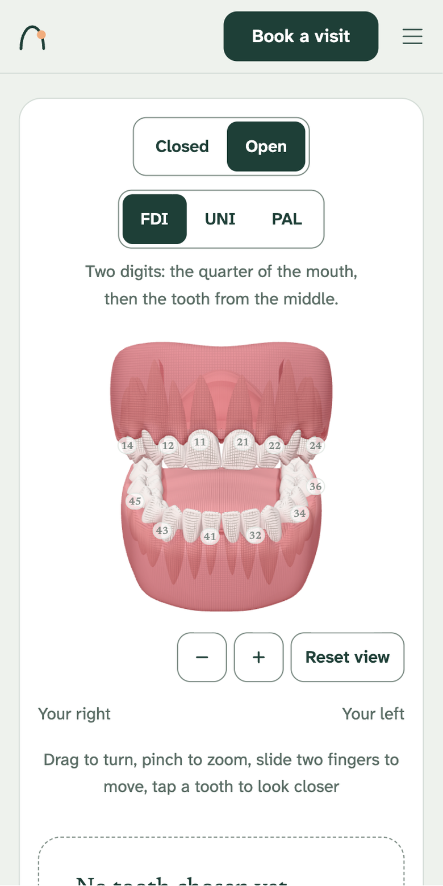
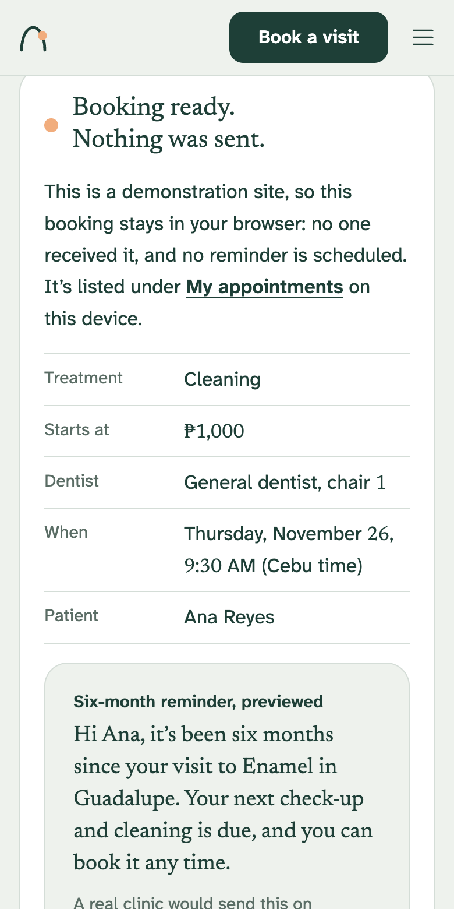

# Enamel

Enamel is a family dental clinic in Guadalupe, Cebu City, with every starting price on its website. It's a concept: the
clinic, the dentists and the bookings are made up, and nothing on the site is sent anywhere. The site shows how a small
clinic could put its prices, its HMO paperwork and its booking on a few calm pages.

  
  

## Pages

- **Home** (`/enamel/`): "Book a visit" beside a card of everyday starting prices (each row books that treatment), the
  tooth chart from Treatments ("Show us where it hurts"), braces paid monthly, who is in on which days with the hours,
  and a closing "Book your visit". The footer is one clinic card: the hours and "Book a visit" on one side, the links
  and the newsletter on the other.
- **Treatments and prices** (`/enamel/treatments/`): the full price list with its filter, and the tooth chart.
- **New patients** (`/enamel/new-patients/`): the first visit step by step, the HMO checklist, payment and the FAQ.
- **Dentists and hours** (`/enamel/team/`): who works which chair and which days, and the clinic hours.
- **Book a visit** (`/enamel/book/`): the booking.
- **My account** (`/enamel/account/`): a two-step sign-in (your name and an email or mobile number, then a code shown
  on screen), then the appointments booked on this device, each opening to its full details with Reschedule and
  Cancel. Visits that have passed move to a "Past visits" list, kept as a record.
- **About, Contact, Terms of Service, Privacy Policy, Cookie Policy, Accessibility**, linked from the footer.

## What you can do

- Read the price list: 16 treatments in six groups, each with a starting price, how long it takes, how many visits,
  what's included and how HMO plans usually treat it. Filter by group and open any row.
- Pick a tooth on a 3D model of all 32 adult teeth: both arches biting, seen from the front, with the roots showing
  faintly through a pink gum. Closed and Open part the jaws to show the inside of the mouth, with the roof over the
  upper teeth and the floor inside the lower ones. Drag to turn it (up to 80° each way, so it never ends up back to
  front); pinch, Ctrl or ⌘ and scroll, or use the buttons to zoom; slide two fingers or Shift and drag to move it. Tap
  or click a tooth to see its usual treatments with their prices, and a close-up: the tooth lifts out of its socket and
  you can look inside at the dentin, the pulp and each canal, or name its cusps, grooves, ridges and root tips. Short
  notes say how many roots and canals it usually has and when it comes in. Numbers show in FDI, Universal or Palmer.
  The model faces you the way a dentist sees it, so your right side is on the left, and it loads only when you scroll
  near it. It works with a mouse, a finger or the keyboard; where 3D can't run (or without JavaScript), the flat chart
  of the same teeth takes its place, and on a phone there's a plain list of teeth as an alternative.
- Press "Book this" on any treatment to open the booking with it already chosen (`/enamel/book/?service=filling`).
- Book in four steps (five for braces): treatment, day, time, then the patient's name and an optional HMO. General
  treatments are booked with "any general dentist": a time is free when either chair is, and confirming gives it to the
  first free one. Braces ask for the dentist, because they go to the orthodontist, who is in on Saturdays only. The
  days sit in a grid by weekday, Monday to Saturday; Sundays never appear, and lunch hour is blocked.
- Finish with a confirmation that says nothing was sent, a preview of the reminder a real clinic would send six months
  later, and, when an HMO was given, the HMO checklist for that treatment.
- Sign in with a first name and an email or mobile number (the code is shown on screen); the header then greets you by
  name. On a phone, the menu is a drawer from the right with today's hours and "Book a visit". Open any booking under My appointments to see its price, dentist, time, HMO checklist and reminder, reschedule
  it (the new time replaces the old one), or cancel it after a confirm. The HMO checklist shows only for a visit that
  has an HMO. Nothing is sent anywhere.
- Read what a first visit involves, what to bring for an HMO, who works which day, the hours and the FAQ.

## Where the content comes from

The business, its prices and its services come from the brief in the portfolio's design spec. There are no reviews, ratings, staff names, addresses, phone numbers
or social accounts, because none of them would be true. The prices are examples, and the site says so in its footer
  dialog and Terms page, not beside each price. The braces package adds up from one source in `app/lib/services.ts`
  (₱45,000: ₱9,000 down, then ₱1,500 a month for 24 months).

Times, open days and free slots are always worked out in Cebu time (Asia/Manila), so a visitor in another time zone sees
the clinic's calendar, not their own. Taken slots are generated the same way for every visitor, so the diary looks
lived-in without pretending to be live; the visitor's own bookings take their slots on top of that.

## Disclaimer

The site itself says: "Enamel is a concept brand. This is a demonstration site: nothing you enter here is sent, and no
payments are taken." It describes treatments and what a visit involves and gives no health advice. Enamel was designed
and built by Van Omar Benaires; the site doesn't name him, because it is presented as a real product.

## License

The code is released under the [MIT License](LICENSE). The fonts, Newsreader and Atkinson Hyperlegible Next, keep their
SIL Open Font License 1.1, and three.js, which draws the 3D tooth model, keeps its MIT License; see
[REFERENCES.md](REFERENCES.md).

Running it locally? See [DEVELOPMENT.md](DEVELOPMENT.md).
